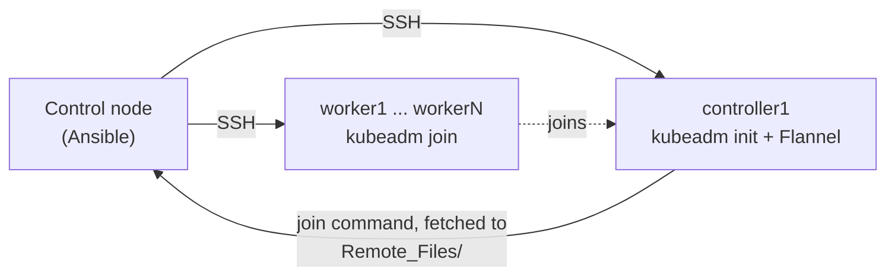

# Kubernetes Cluster with Ansible


An Ansible role that builds a Kubernetes 1.28 cluster with kubeadm on Ubuntu machines: one control plane node and any number of workers, from bare OS to `Ready` nodes in one command. It also covers adding workers later and tearing the cluster down.

## Contents

- [How it works](#how-it-works)
- [Repository layout](#repository-layout)
- [Requirements](#requirements)
- [Quick start](#quick-start)
- [Add workers to a running cluster](#add-workers-to-a-running-cluster)
- [Reset the cluster](#reset-the-cluster)
- [Configuration](#configuration)
- [Design choices](#design-choices)
- [Limitations](#limitations)

## How it works



`site.yml` applies the `kubernetes_cluster` role to every host. The role runs three task files, chosen by inventory group:

| Task file | Runs on | What it does |
|---|---|---|
| `prerequisites.yml` | every node | Upgrades the OS packages, installs containerd with `SystemdCgroup = true`, disables swap (now and in `/etc/fstab`), loads `overlay` and `br_netfilter`, sets the bridge and IP forwarding sysctls, installs kubeadm, kubelet and kubectl 1.28 from `pkgs.k8s.io` and holds them with dpkg. |
| `master.yml` | `[controllers]` | Runs `kubeadm init` (pod CIDR `10.244.0.0/16`), copies the admin kubeconfig to the SSH user's `~/.kube/config`, installs Flannel v0.27.3, then generates the join command and fetches it to `Remote_Files/worker_conn_string` on the control node. |
| `worker.yml` | `[workers]` | Runs the fetched join command, one worker at a time. |

The playbook is safe to run again on a built cluster: `kubeadm init` is skipped when `/etc/kubernetes/admin.conf` exists, and the join is skipped when `/etc/kubernetes/kubelet.conf` exists.

## Repository layout

```text
.
├── ansible-install/
│   └── steps.sh                  # installs Ansible on the control node
├── cluster-k8s/
│   ├── inventory.ini             # your nodes
│   ├── requirements.yml          # Ansible collections needed
│   ├── site.yml                  # builds the cluster
│   ├── reset.yml                 # tears the cluster down
│   ├── Remote_Files/             # join command, written at runtime (git-ignored)
│   └── roles/kubernetes_cluster/
│       ├── defaults/main.yml     # versions and pod CIDR
│       ├── vars/main.yml         # package lists
│       ├── handlers/main.yml     # containerd restart
│       ├── templates/k8s_worker_node_connection.j2
│       └── tasks/
│           ├── main.yml          # picks the task files below
│           ├── prerequisites.yml
│           ├── master.yml
│           └── worker.yml
└── Screenshots/
```

## Requirements

**Cluster nodes**

- Ubuntu 22.04 or 24.04 LTS, at least 2 CPUs and 2 GB RAM each (kubeadm minimum, 4 GB recommended for the controller).
- A unique hostname per node.
- Internet access to `pkgs.k8s.io`, `registry.k8s.io`, `github.com` and `ghcr.io`.
- A user that the control node can reach over SSH with a key, and that can use `sudo` without a password. Otherwise add `-K` to every `ansible-playbook` command to type the sudo password.

**Control node** (the machine you run Ansible from)

- Ansible 2.10 or newer, with the `community.general` collection. The full `ansible` package already includes it. With `ansible-core` only, run `ansible-galaxy collection install -r requirements.yml` from `cluster-k8s/`.
- The SSH private key set in `inventory.ini` (`~/.ssh/id_rsa` by default).

On Ubuntu, `ansible-install/steps.sh` installs Ansible and gives the current user passwordless sudo.

## Quick start

**1. Clone the repository**

```bash
git clone https://github.com/raslenraslen/kubernetes-ansible-roles.git
cd kubernetes-ansible-roles/cluster-k8s
```

**2. Describe your nodes in `inventory.ini`**

Put one host in `[controllers]` and one or more in `[workers]`. Set `ansible_host` to the node IP and `ansible_user` to the SSH user.

```ini
[all:vars]
ansible_ssh_private_key_file=~/.ssh/id_rsa
ansible_ssh_common_args="-o ControlPath=/tmp/ssh_mux_%h_%p_%r"

[controllers]
controller1 ansible_host=192.168.216.142 ansible_user=raslen

[workers]
worker1 ansible_host=192.168.216.139 ansible_user=raslenworker
```

**3. Check that every node answers**

```bash
ansible all -i inventory.ini -m ping
```

Each host must reply `"ping": "pong"`.

**4. Build the cluster**

```bash
ansible-playbook -i inventory.ini site.yml
```

**5. Verify, on the controller**

```bash
kubectl get nodes
```

Every node must be `Ready`:


## Add workers to a running cluster

The join command contains a bootstrap token that expires after 24 hours, so refresh it before adding a node.

**1.** Add the new host to `[workers]` in `inventory.ini`, for example:

```ini
worker2 ansible_host=192.168.216.143 ansible_user=raslenworker
```

**2.** Generate a fresh join command. This only runs the join-command tasks on the controller and changes nothing else:

```bash
ansible-playbook -i inventory.ini site.yml -l controllers --tags join_string
```

**3.** Prepare and join only the new node:

```bash
ansible-playbook -i inventory.ini site.yml -l worker2
```

To add several nodes at once, list them: `-l worker2,worker3`.

## Reset the cluster

> **Warning:** this destroys the cluster and all its workloads.

```bash
ansible-playbook -i inventory.ini reset.yml
```

On every node it runs `kubeadm reset -f`, then deletes `/etc/kubernetes`, `/var/lib/etcd`, `/etc/cni/net.d` and the SSH user's `~/.kube/config`. The packages stay installed, so `site.yml` can rebuild the cluster right away.

`kubeadm reset` does not flush iptables rules or delete the `cni0` and `flannel.1` interfaces. Reboot the nodes if you need a fully clean network state.

To remove a single worker, run `kubectl delete node <name>` on the controller, then `ansible-playbook -i inventory.ini reset.yml -l <name>`.

## Configuration

Defaults live in `cluster-k8s/roles/kubernetes_cluster/defaults/main.yml`. Set them before building a cluster, not on a running one.

| Variable | Default | Purpose |
|---|---|---|
| `kube_version` | `1.28` | Kubernetes minor version of the `pkgs.k8s.io` apt repository |
| `pod_network_cidr` | `10.244.0.0/16` | Pod CIDR passed to `kubeadm init`. Must match the `Network` value of the Flannel manifest |
| `flannel_version` | `v0.27.3` | Flannel release whose `kube-flannel.yml` is applied |

## Design choices

- **kubeadm** is the upstream bootstrap tool, so the cluster matches the official documentation with no extra layer to learn.
- **containerd with the systemd cgroup driver**: kubeadm configures kubelet with the systemd driver by default since Kubernetes 1.22, and the container runtime must use the same driver.
- **Pinned versions**: Kubernetes through the versioned apt repository plus a dpkg hold, Flannel through a release tag. An upstream release cannot change the cluster between two runs.
- **Join command fetched to the control node**: workers never need SSH access to the controller.

## Limitations

- **Single control plane.** `kubeadm init` uses the controller IP as the endpoint, so the cluster is not highly available.
- **Ubuntu with containerd 1.x.** The `SystemdCgroup` edit targets the containerd 1.x configuration layout, and the tasks use `apt`.
- **No version upgrades.** The Kubernetes packages are held; upgrade them with `kubeadm upgrade`.
- **Every run upgrades the OS packages and restarts containerd**, because the containerd configuration is rebuilt from the defaults on each run.
